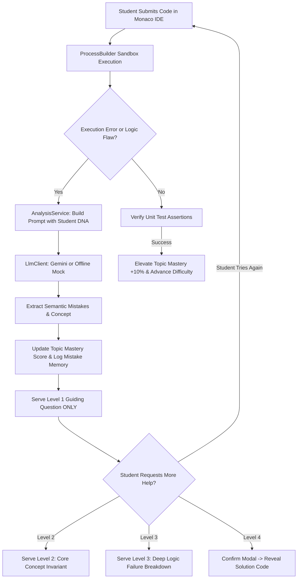

# System Architecture & Technical Specification
## Adaptive AI Coding Mentor (Final Year B.E. IT Project)

---

## 1. High-Level Architectural Overview

The **Adaptive AI Coding Mentor** is an enterprise-grade, hybrid full-stack web application designed to counteract student cognitive overreliance on generative AI. Rather than generating code on demand (like ChatGPT or GitHub Copilot), it acts as an automated Socratic tutor that diagnoses semantic errors, tracks longitudinal behavioral patterns, and dispenses progressive scaffolding level-by-level without revealing the answer.

### Architectural Paradigm: Hybrid MVC + Decoupled SPA
```
+---------------------------------------------------------------------------------------+
|                                    CLIENT BROWSER                                      |
|                                                                                       |
|   Server-Rendered JSP Views (Phase 2 & 8)           Client-Side React 18 SPA (Phase 5) |
|   - index.jsp (Pedagogical Landing Page)            - Monaco IDE Code Editor          |
|   - login.jsp (Glassmorphism Authentication)        - Socratic AI Mentor Panel        |
|   - register.jsp (Student Profile Creation)         - 4-Tier Progressive Hint Ladder  |
|   - dashboard.jsp (Student Progress Summary)        - Sandboxed Output Console        |
|   - admin/dashboard.jsp (Faculty Telemetry)         - Coding DNA & Mistake Analytics  |
+---------------------------------------------------------------------------------------+
                                           | HTTP / Session Cookie (HttpOnly)
                                           v
+---------------------------------------------------------------------------------------+
|                              JAKARTA EE BACKEND (SERVLET 6.0)                         |
|                                                                                       |
|  [Security & Auth Filters]                                                            |
|    - AuthFilter (/app/*, /api/*)        - AdminFilter (/admin/*)    - CorsFilter       |
|                                                                                       |
|  [Page Controllers]                     [JSON REST API Servlets]                      |
|    - HomeServlet, LoginServlet,           - /api/analyze    - /api/hint               |
|      RegisterServlet, LogoutServlet,      - /api/solution   - /api/run                |
|      DashboardServlet, AdminDashboard     - /api/profile    - /api/mistakes           |
|                                           - /api/problems   - /api/submissions        |
|                                           - /api/me                                   |
|                                                                                       |
|  [Domain Services]                                                                    |
|    - AnalysisService: Orchestrates submission, LLM diagnosis, mistake logs & DNA     |
|    - HintService: Enforces server-side ceiling (Level 1-3) & explicit Level 4 reveal  |
|    - CodeRunnerService: Sandboxed compilation & execution with static security check  |
|    - MistakeTrendService: 3-week rolling window analytics & remediation recommendations|
|    - ProblemGeneratorService: Isomorphic synthesis & adaptive difficulty calibration  |
|                                                                                       |
|  [LLM Dual-Engine Layer]                                                              |
|    - LlmClient (Interface)                                                            |
|    - GeminiLlmClient (HTTP/2 java.net.http, Google Gemini 2.0 Flash REST API)         |
|    - MockLlmClient (Zero-dependency offline mode with realistic Socratic outputs)     |
|                                                                                       |
|  [Data Access Objects (DAO) - HikariCP Pool]                                          |
|    - UserDAO, ProblemDAO, SubmissionDAO, MistakeDAO, HintDAO, MasteryDAO, ProgressDAO|
+---------------------------------------------------------------------------------------+
                                           | JDBC PreparedStatement (Zero SQLi)
                                           v
+---------------------------------------------------------------------------------------+
|                                    PERSISTENCE (MySQL 8.0)                            |
|  - users                     - problems                  - submissions                |
|  - mistakes                  - hint_sessions             - hints                      |
|  - topic_mastery (DNA)       - user_problem_progress                                  |
+---------------------------------------------------------------------------------------+
```

---

## 2. The Socratic Pedagogical Learning Loop

Traditional code assistants short-circuit learning by generating complete solutions. Our system enforces an interactive, multi-stage pedagogical cycle:



---

## 3. Server-Enforced 4-Level Progressive Hint Ladder

A critical innovation of this project is that **hint level constraints are enforced strictly on the server**, not merely through UI hiding:

| Level | Pedagogical Designation | Server Constraint & Rule | Example Output |
|---|---|---|---|
| **Level 1** | **Guiding Question** | Points out the suspect area or boundary condition. **No fixed code, no direct answers.** | *"Notice the upper limit of your for-loop. Does accessing index `arr[i]` on the last iteration exceed valid bounds?"* |
| **Level 2** | **Conceptual Explanation** | Explains the computer science concept or invariant without referencing the fix. | *"In Java and Python, arrays are 0-indexed. An array of size N has valid indices from `0` to `N - 1`."* |
| **Level 3** | **Deep Failure Diagnosis** | Details *why* the student's code fails and explains the exact logical change required in plain English. | *"Change `i <= arr.length` to `i < arr.length` so the loop terminates before indexing past the last element."* |
| **Level 4** | **Full Reference Solution** | Accessible **only** via `/api/solution`. Requires explicit user confirmation. Penalizes mastery score slightly. | Full corrected source code with pedagogical comments. |

### Server-Side Level Safeguards:
- Calling `/api/hint` **cannot advance past Level 3**. If a client attempts to bypass the UI, the servlet returns HTTP 400 with an error.
- The prompt sent to the LLM injects `AUTHORIZATION: LEVEL X OF 4` with strict schema rules so the model never outputs code unless authorized.

---

## 4. Student Coding DNA & Bayesian Mastery Formula

Every student possesses a persistent **Coding DNA Profile** maintained in `topic_mastery`.

### Topic Mastery Scoring Formula
On each submission, mastery score $M \in [0, 100]$ updates according to learning performance:

1. **On Correct Solution (Diminishing Returns Formula):**
   $$M_{new} = \min(100.0, M_{old} + (100.0 - M_{old}) \times 0.15)$$
   *Rationale:* As mastery approaches 100%, each additional solved problem yields smaller incremental gains, preventing rapid score inflation.

2. **On Semantic Mistake (Proportional Penalty Formula):**
   $$M_{new} = \max(10.0, M_{old} - M_{old} \times 0.10)$$
   *Rationale:* High-mastery students lose more score on errors than beginners, accurately modeling competency decay.

3. **Assistance Level Calibration:**
   - $M < 30$: `HIGH` assistance (simpler vocabulary, smaller increments)
   - $30 \le M < 60$: `MEDIUM` assistance
   - $M \ge 60$: `LOW` assistance (technical vocabulary, brief hints)

---

## 5. Mistake Memory & 3-Week Trend Engine

To diagnose whether a student is genuinely internalizing concepts or repeatedly falling into the same anti-patterns, the system implements **Longitudinal Mistake Memory**:

- Every detected mistake is stored with: `(user_id, submission_id, mistake_type, topic, line_number, created_at)`.
- The system aggregates mistakes across **three rolling 7-day evaluation windows**:
  - $W_1$: Recent week (Days 0–7)
  - $W_2$: Prior week (Days 7–14)
  - $W_3$: Oldest baseline (Days 14–21)

### Trend Classification Matrix
$$\text{Trend} = \begin{cases} 
\text{IMPROVING} & \text{if } W_1 < W_3 \text{ or } (W_1 == W_3 \text{ and } W_1 < W_2) \\
\text{DETERIORATING} & \text{if } W_1 > W_3 \text{ or } (W_1 == W_3 \text{ and } W_1 > W_2) \\
\text{STABLE} & \text{otherwise}
\end{cases}$$

When a mistake pattern is classified as `DETERIORATING`, the platform displays an alert banner on the student's dashboard and prescribes targeted concept refresher modules (e.g. *"Mastering Loop Termination & Zero-Indexed Arrays"*).

---

## 6. "Similar but Different" Isomorphic Problem Synthesis

To test whether a student has truly grasped a concept rather than memorizing a specific problem, the `ProblemGeneratorService` synthesizes isomorphic challenges:
- Extracts the underlying computational invariant (e.g., Two-Pointer, Recursion Base Case, State Machine).
- Asks the LLM to generate a novel problem with an identical underlying algorithmic graph but completely different narrative, variable names, and constraints.
- Links the new problem to the parent via `generated_from_problem_id` to evaluate transfer of learning.

---

## 7. Sandboxed Code Execution Pipeline

Student submissions are compiled and executed using Java `ProcessBuilder` with multi-layered defensive safeguards:

1. **Static AST / Lexical Security Filter:**
   Rejects submissions containing dangerous tokens prior to compilation:
   - Java: `System.exit`, `Runtime.getRuntime`, `ProcessBuilder`, `java.lang.reflect`, `java.net.Socket`, `java.io.File`, `java.nio.file`.
   - Python: `import os`, `import sys`, `import subprocess`, `eval(`, `exec(`, `open(`.
2. **Ephemeral Directory Isolation:**
   Code is written into a freshly created temporary directory (`Files.createTempDirectory("aimentor_")`) and compiled with `javac`.
3. **Hard Timeout Enforcement:**
   Processes are granted a maximum execution window of **5 seconds** (`process.waitFor(5, TimeUnit.SECONDS)`). If exceeded, the process is forcibly terminated (`process.destroyForcibly()`) and a `TIMEOUT` status is returned.
4. **Output Stream Limiter:**
   Stdout/stderr streams are capped at 10,000 characters to prevent memory exhaustion from infinite `while(true) println()` loops.
5. **Deterministic Cleanup:**
   Temporary compilation directories and `.class` artifacts are recursively deleted in a `finally` block.
